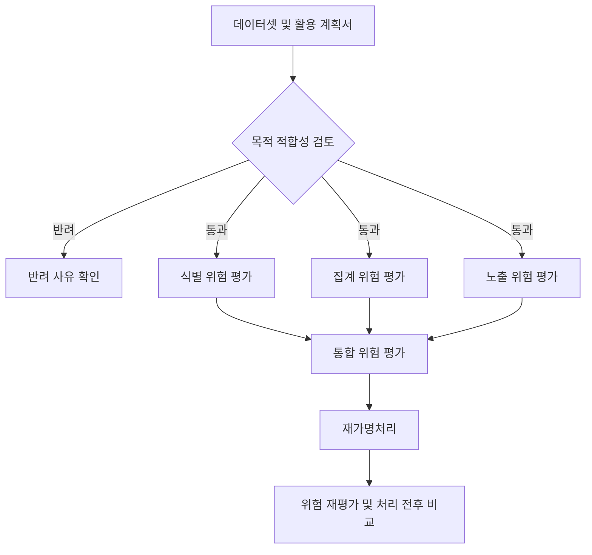

# PRIVIEW

**Pseudonymized Data Risk Assessment and Re-pseudonymization System**

가명정보 위험 평가 및 재가명처리 시스템

## 프로젝트 개요

PRIVIEW는 가명정보 활용 과정에서 발생할 수 있는 재식별 및 민감정보 추론 위험을 평가하고, 위험 속성에 대한 추가 가명처리와 처리 후 재평가를 지원하는 시스템입니다. 서울여자대학교 정보보호학부 PBL 졸업 프로젝트로 개발되었습니다.

## 주요 기능

| 기능 | 설명 |
|---|---|
| 목적 적합성 검토 | 활용 계획서와 선택 목적을 바탕으로 적합성을 검토하고 가명처리 검토 대상 속성을 선별합니다. |
| 식별 위험 평가 | CorrectMatch 기반 유일성 및 정확 매칭률을 산출하고 속성 및 조합별 위험을 평가합니다. |
| 집계 위험 평가 | 비식별 속성 조합으로 민감정보를 예측하고 다중 모델 및 이중 기준을 적용하여 위험 등급을 산출합니다. |
| 노출 위험 평가 | 민감정보 탐지와 내부 및 외부 노출 지표를 기반으로 위험을 평가합니다. |
| 통합 위험 평가 | 모듈별 위험 등급을 통합하여 데이터셋의 위험 수준을 제시합니다. |
| 재가명처리 | 위험 속성을 추천하고 속성 유형에 따른 처리 기법과 강도를 탐색합니다. |
| 재평가 | 처리 전후의 위험 등급과 데이터 유용성을 비교합니다. |
| 대시보드 | 평가 결과를 시각화하고 적정성 검토서 생성을 지원합니다. |

## 시스템 흐름



목적 적합성 검토는 선행 단계로 수행합니다. 통과한 경우 식별, 집계, 노출 위험 등급 중 가장 높은 등급을 통합 위험도로 적용합니다. 각 모듈의 지표는 단위와 의미가 다르므로 단일 점수로 단순 합산하지 않습니다.

재가명처리 단계에서는 목적 적합성 검토 대상, 식별 고위험 속성, 노출 위험 우선 처리 속성 등을 추천합니다. 집계 고위험 속성은 H 비율이 높은 순서로 상위 절반(올림)을 기본 추천하며, 사용자가 처리 대상을 추가할 수 있습니다. 자동 처리의 기본 목표는 저위험이며 기본 실행은 1회입니다. 처리 결과는 원본과 별도로 저장하고 재평가 결과를 비교할 수 있습니다.

## 프로젝트 구조

```text
PRIVIEW/
├── app.py                         Flask 애플리케이션
├── experiment.py                  재가명처리 실험 실행
├── requirements.txt               Python 의존성
├── assets/                        시각화 리소스
├── experiments/                   실험 안내 및 샘플
├── exposure_pipeline/             민감정보 탐지 및 노출 위험 평가
├── modules/
│   ├── purpose/                   목적 적합성 검토
│   ├── correctmatch_merged/        식별 위험 평가
│   ├── aggregation_risk_system/    집계 위험 평가
│   ├── integration/               통합 평가 및 결과 비교
│   ├── pseudonymization_pipeline/  처리 기법 및 강도 탐색
│   └── repseudonymization/         재가명처리
├── static/                        CSS 및 JavaScript
├── templates/                     대시보드 화면
├── tests/                         기능 검증
└── tools/                         평가 결과 검증 도구
```

## 설치 및 실행

Python 가상환경을 생성합니다.

```bash
python -m venv .venv
```

Windows PowerShell:

```powershell
.venv\Scripts\Activate.ps1
```

macOS 및 Linux:

```bash
source .venv/bin/activate
```

의존성을 설치하고 애플리케이션을 실행합니다.

```bash
pip install -r requirements.txt
python app.py
```

브라우저에서 [http://127.0.0.1:5000](http://127.0.0.1:5000)에 접속합니다.

- 목적 적합성 검토에는 KoNLPy의 Okt 형태소 분석기를 위한 Java 런타임이 필요합니다.
- 식별 위험 평가에는 Julia 및 CorrectMatch.jl이 필요합니다. 최초 실행 시 환경 구성에 시간이 걸릴 수 있습니다.
- 집계 위험 평가의 실행 시간은 속성 조합 수와 사용 모델 수에 따라 달라집니다.

## 입력 데이터

| 항목 | 지원 형식 또는 조건 |
|---|---|
| 데이터셋 | CSV, XLSX, XLS, TSV, JSON, Parquet |
| 활용 계획서 | 텍스트 추출이 가능한 PDF |
| 활용 목적 | 통계 작성, 과학적 연구, 공익적 기록보존 |
| 집계 타깃 | 민감정보 예측 대상 컬럼 |

## 선택적 API 설정

OpenAI API는 목적 적합성 검토의 문맥 보조 판정에 사용할 수 있습니다. API 키는 실행 환경의 `OPENAI_API_KEY` 환경변수로 설정합니다. 키가 없거나 호출에 실패하면 규칙 기반 판정을 사용합니다.

API 사용 시 판정에 필요한 문서 텍스트가 외부 서비스에 전달될 수 있습니다. 민감정보 또는 기밀정보가 포함된 자료를 사용하기 전에 적법성 및 외부 전송 조건을 확인해야 합니다.

## 실험 및 모듈 문서

- [재가명처리 실험 실행](experiments/README.md)
- [노출 위험 평가](exposure_pipeline/README.md)
- [목적 적합성 검토](modules/purpose/README.txt)
- [식별 위험 평가](modules/correctmatch_merged/README.md)
- [집계 위험 평가](modules/aggregation_risk_system/README.md)

## 적용 범위

본 시스템은 가명정보의 위험 평가 및 적정성 검토를 지원하는 연구용 도구입니다. 평가 결과는 법적 적정성 또는 재식별 불가능성을 보증하지 않으며, 실제 데이터 활용 시에는 처리 목적과 데이터 특성, 결합 가능성 및 관리적 보호조치를 함께 검토해야 합니다.
